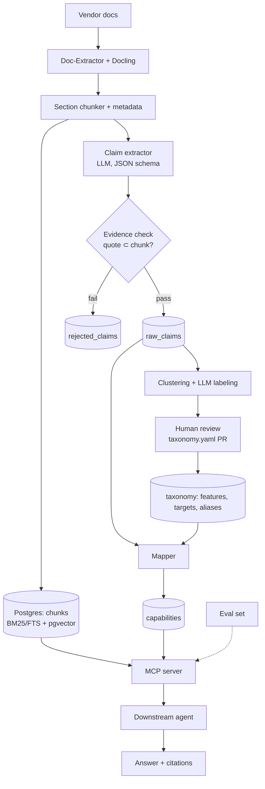

# Backup Vendor Knowledge System: High-Level Design

> Status: v1 draft, Nov 2026. Supersedes the Graphiti-based Graph RAG pipeline.
> Owner: Everton. Build environment: Claude Code + homelab.

## 1. Goal

A downstream AI agent answers questions about 30–40 backup vendors **precisely and with citations**, using their technical documentation (ingested by Doc-Extractor). That covers two kinds of question:

- **Single-vendor detail questions**, e.g. "What are Rubrik's limits for SQL Server log backup frequency?"
- **Cross-vendor aggregate questions**, e.g. "Which vendors support immutability for AWS RDS, and under what conditions?"

**Precision principle: cite or abstain.** Every factual statement in an answer must trace to a stored source span. If no source supports it, the agent says it doesn't know. Optimizing for that is more achievable than "always right", and it can be measured.

### Non-goals (v1)
- Time-travel or temporal reasoning across doc versions (we store the version, but answers default to the latest docs).
- Pricing and licensing comparisons (docs are unreliable here; this can be revisited later).
- A UI. The agent interface is an MCP server.

## 2. Why not Graphiti (decision record)

- Graphiti is designed for evolving, episodic agent memory, but this corpus is a static, versioned set of documents.
- Open entity/relation extraction into triples loses the conditions and limits, and precision depends on exactly those.
- Entity resolution across vendors ("WORM" vs. "Object Lock" vs. "immutable backups") fails silently, so a cross-vendor query can miss vendors without any warning.
- Months of effort went into extraction-model throughput rather than answer quality.

**What we keep from the graph idea:** relationships between features, workloads and vendors live in a normalized capability table plus a growing taxonomy. Cross-vendor questions become SQL queries, and every row is linked to its evidence.

## 3. Architecture



### Component summary

| # | Component | Responsibility | Tech |
|---|-----------|---------------|------|
| 0 | Eval harness | Gold Q&A set; scores answers + citations | Python, pytest-style runner |
| 1 | Ingestion | Docling markdown → section chunks + metadata | Python; Docling service (`docling.home.lan`) |
| 2 | Retrieval | Hybrid search + rerank | Postgres FTS + pgvector; reranker via llama.cpp `--reranking` |
| 3 | Claim extraction | Section → structured claims with verbatim evidence | OpenAI-compatible endpoint (llama.cpp, or an API model for bootstrap) |
| 4 | Taxonomy | Cluster raw strings, propose canonical names, human approves | Embeddings + HDBSCAN/agglomerative; LLM labeling; YAML in git |
| 5 | Capability table | Normalized, queryable facts | Postgres |
| 6 | Agent interface | Tools for the downstream agent | MCP server (replaces the current `graph-rag` MCP) |

## 4. Data model (Postgres)

One database, `vendorkb`, using the `pgvector` extension. Postgres built-in FTS (`tsvector`) is good enough to start with. If ranking quality becomes a problem, switch to ParadeDB `pg_search` for true BM25.

```sql
-- Source documents
documents(
  doc_id        uuid pk,
  vendor        text not null,          -- canonical vendor slug, e.g. 'rubrik'
  product       text,                   -- e.g. 'Rubrik Security Cloud'
  version       text,                   -- doc/product version if known
  title         text,
  url           text,
  content_hash  text unique,            -- idempotent re-ingest
  fetched_at    timestamptz,
  is_latest     boolean default true
)

-- Section-level chunks (retrieval unit + extraction unit)
chunks(
  chunk_id      uuid pk,
  doc_id        uuid fk,
  section_path  text[],                 -- ['Protecting Databases','Amazon RDS','Immutability']
  ordinal       int,
  text          text,
  token_count   int,
  tsv           tsvector,               -- FTS
  embedding     vector(<dim>)
)

-- Open extraction output (never deleted; re-mappable)
raw_claims(
  claim_id      uuid pk,
  chunk_id      uuid fk,
  vendor, product, version  text,
  capability_raw  text,                 -- as the vendor phrases it
  target_raw      text,                 -- workload/platform as phrased, nullable
  support         text check (support in ('supported','partial','not_supported','unclear')),
  conditions      text,                 -- limits, prerequisites, editions
  evidence_quote  text not null,        -- verbatim span from chunk
  extractor_model text,
  prompt_version  text,
  created_at      timestamptz
)

-- Taxonomy (source of truth is taxonomy.yaml in git; these tables are loaded from it)
features(feature_id text pk, name text, category text, definition text, parent_id text null)
targets(target_id text pk, name text, kind text,    -- kind: workload | platform | storage
        parent_id text null)                         -- e.g. aws > aws.rds
aliases(alias text, entity_type text, entity_id text, primary key(alias, entity_type))

-- Normalized capability facts
capabilities(
  cap_id        uuid pk,
  vendor, product, version text,
  feature_id    text fk,
  target_id     text fk null,
  support       text,
  conditions    text,
  claim_id      uuid fk,                -- provenance → raw_claim → chunk → document
  mapping_conf  real,
  taxonomy_version text
)
```

**Key properties**
- **Provenance chain:** each capability links to a raw_claim, then a chunk, then a document and URL. Nothing exists without evidence.
- **Re-mappability:** raw claims are kept permanently. When the taxonomy changes, `capabilities` is rebuilt from `raw_claims` without re-running extraction.
- **Idempotency:** `content_hash` on documents and a `(chunk_id, prompt_version, extractor_model)` key on extraction runs.

## 5. Pipeline stages

### 5.1 Ingestion and chunking
- Input: Docling markdown/JSON from Doc-Extractor, with vendor/product/version/url metadata attached at ingest.
- Chunk by heading hierarchy, keeping `section_path`. Target 300–1,200 tokens. Split oversized sections on sub-headings or paragraphs. Merge tiny sections into their parent.
- Keep tables intact. Never split a table across chunks, and prepend the section path to the chunk text so it is self-describing.
- Embeddings use the existing homelab embedding service. Record the model name and dimension in config.

### 5.2 Hybrid retrieval
1. FTS top-k (k=50) and vector top-k (k=50), filtered by vendor/product when given.
2. Merge with Reciprocal Rank Fusion.
3. Rerank the top ~40 with the cross-encoder reranker on llama.cpp (`/v1/rerank`) and return the top 8–10.
4. `read_section` can expand to neighboring chunks or the full section.

### 5.3 Claim extraction
- One LLM call per chunk, with output constrained by JSON schema (llama.cpp `json_schema`/grammar, or API structured outputs).
- Output: a list of claims (schema in §4). **`evidence_quote` is mandatory.**
- **Evidence gate:** a claim is accepted only if `evidence_quote` appears in the chunk text after whitespace/case normalization, using a fuzzy match ≥ 0.9. Failures go to `rejected_claims` for analysis. This is the main hallucination guard.
- Chunks with no capability content return `[]`. Many will, and that's fine.
- **Model strategy:**
  1. *Bootstrap:* a strong API model extracts claims from the 5 pilot vendors. Its output is both the pilot data and the training data.
  2. *Distill:* retrain the Qwen3.5-4B LoRA (Unsloth, bf16 LoRA) on that data, reusing parts of the old Graphiti dataset only where it can be relabeled.
  3. *Run at scale:* use the 4B on the homelab for the remaining vendors and re-runs. Gate it by its agreement with the bootstrap model on a held-out set.
- The extractor is configured only through an OpenAI-compatible base URL and model name, so models can be swapped freely.

### 5.4 Taxonomy normalization (growing, not fixed)
1. Embed all distinct `capability_raw` and `target_raw` strings.
2. Cluster them, using HDBSCAN or agglomerative clustering with a distance threshold.
3. For each cluster, an LLM proposes `{canonical_id, name, category, definition, aliases[]}` along with whether it matches an existing feature.
4. Proposals are written as a diff to `taxonomy/taxonomy.yaml`. **Human review happens as a git PR.** Everton approves or edits, and Claude can help batch-review.
5. The Mapper assigns each raw claim to a feature or target in this order: exact alias match, then embedding nearest neighbor above a threshold, then LLM adjudication. Anything below the threshold stays **unmapped**. Unmapped claims are still searchable through retrieval and are surfaced in the next review batch.
- Seed top-level categories are Workloads, Platforms, Storage targets, Data protection, Security, Recovery and Management. Licensing is out of scope for v1.
- Targets are hierarchical (`aws` → `aws.rds` → `aws.rds.postgres`), so a query on `aws.rds` includes its children.

### 5.5 Capability table build
- `capabilities` is a derived table, rebuilt from `raw_claims` and the current taxonomy version.
- When several claims conflict for the same (vendor, product, feature, target), the latest doc version wins. Conflicts are recorded so the agent can say so.

## 6. Agent interface (MCP server)

| Tool | Purpose |
|------|---------|
| `list_vendors()` | Vendors, products, doc coverage stats |
| `list_features(query?)` / `list_targets(query?)` | Browse taxonomy; resolve user wording → IDs via aliases |
| `query_capabilities(feature, target?, vendor?, support?)` | Cross-vendor matrix with conditions + citations |
| `search_docs(query, vendor?, product?, k?)` | Hybrid search, returns chunks with citations |
| `read_section(chunk_id, expand?)` | Full section text + neighbors |

**Answering rules (system prompt for the downstream agent):**
- Every claim cites a `chunk_id`/URL.
- For aggregate questions, use `query_capabilities` first and then **verify gaps with `search_docs`**. A vendor missing from the table doesn't mean the vendor doesn't support the feature. The answer should separate "supported", "not supported" and "no evidence found".
- If nothing supports an answer, say unknown.

## 7. Evaluation (build first, run always)
- `eval/questions.yaml` holds 50–100 questions. Each has a type (single-vendor, cross-vendor, negative/unsupported, conditional), gold answer facts, and gold source URLs or sections.
- Metrics:
  - **Fact recall:** the share of gold facts present in the answer.
  - **Citation precision:** the share of cited sources that actually support their claim, checked by an LLM judge and spot-checked by hand.
  - **Vendor recall** on cross-vendor questions.
  - **Abstention correctness** on unanswerable questions.
- Extraction-level metrics on a labeled sample: claim precision/recall and evidence-gate pass rate.
- Run the full eval after every milestone and keep the results in `eval/runs/`.

## 8. Infrastructure constraints
- GPU: Quadro P6000 (24 GB, Pascal sm_61). The chunking and embedding services already use about 5.5 GB. Use only the CUDA 12.6 / torch builds that support Pascal.
- llama.cpp runs in router mode on `:8080` with presets in `/etc/llama.cpp/models.ini`, and `--reranking` is enabled.
- Docling is served at `http://docling.home.lan` with API-key auth.
- Postgres and pgvector run in Docker Compose on the homelab.
- Secrets live in `.env` and are never committed.

## 9. Repo layout (proposed)

```
vendorkb/
  DESIGN.md
  CLAUDE.md                 # conventions for Claude Code
  docker-compose.yml        # postgres+pgvector (+ mcp server)
  pyproject.toml            # uv-managed
  .env.example
  migrations/               # SQL migrations
  taxonomy/taxonomy.yaml    # reviewed source of truth
  prompts/extract_claims.v1.md
  src/vendorkb/
    config.py
    ingest/      (docling client, chunker)
    index/       (embeddings, fts, hybrid search, rerank)
    extract/     (llm client, schema, evidence gate, runner)
    taxonomy/    (cluster, propose, load, mapper)
    capabilities/(build)
    mcp/         (server + tools)
    cli.py       # vendorkb ingest|index|extract|cluster|map|build|eval
  eval/questions.yaml
  eval/runner.py
  tests/
```

## 10. Milestones

| M | Deliverable | Done when |
|---|-------------|-----------|
| M0 | Repo skeleton, Postgres+pgvector up, migrations, config, CLI stub, eval harness with ≥20 questions | `vendorkb eval` runs end-to-end (even if it scores 0) |
| M1 | Ingestion + chunking + hybrid retrieval for the 5 pilot vendors (Commvault, Cohesity, Rubrik, Druva, AvePoint) | Retrieval eval: gold section in top-10 for ≥85% of questions |
| M2 | MCP server with `search_docs` / `read_section` (RAG-only agent baseline) | Baseline answer eval recorded |
| M3 | Claim extraction with bootstrap API model + evidence gate on pilot vendors | ≥90% gate pass rate; manual spot-check precision ≥95% on 100 claims |
| M4 | Clustering + taxonomy v1 reviewed + mapper + `capabilities` + `query_capabilities` tool | Cross-vendor questions improve vs. M2 baseline; vendor recall measured |
| M5 | Retrain 4B on bootstrap data; run on homelab; scale to all vendors | 4B agreement with bootstrap ≥90% on held-out; full corpus loaded |

## 11. Open questions
- Doc-Extractor output contract: what metadata does it already emit (vendor, product, version, URL)?
- Which embedding model is the homelab using, and what is its dimension? Is it good enough for technical text, or should a better one be evaluated in M1?
- Which bootstrap model and budget should extraction use (Claude API vs. OpenRouter)?
- Version handling: is "latest docs only" acceptable for v1?
- Who else writes eval questions? Domain colleagues would improve coverage.
